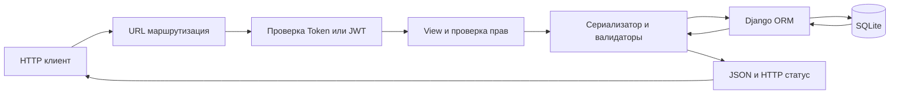
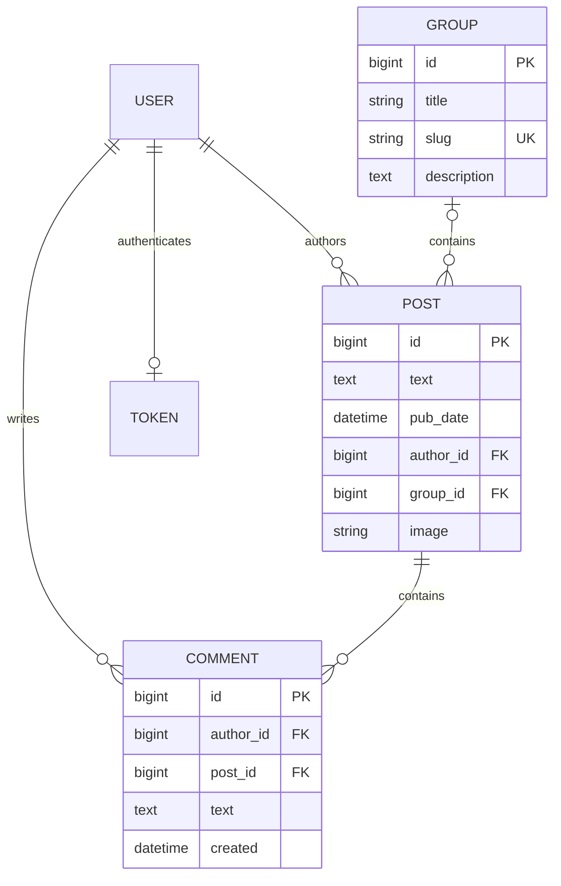
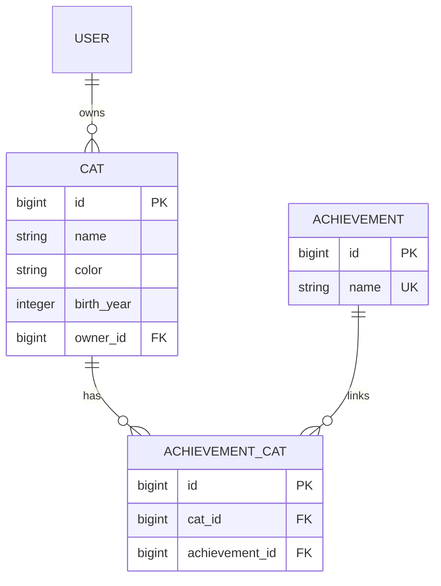

# Архитектура и данные

## Путь запроса

Неверные данные останавливаются на валидации и дают 400. Отсутствие или недействительность токена — 401. Недостаточные права на существующий объект — 403. Отсутствие объекта — 404. Неподдерживаемый метод — 405. Успешное создание — 201, чтение/изменение — 200, удаление — 204 без тела.

## Yatube

`image` хранит путь к файлу; файл лежит в `media/posts/`. `group_id` допускает NULL. Удаление пользователя каскадно удаляет его публикации и комментарии; удаление группы сохраняет публикации, удаление поста удаляет его комментарии. Группы читаются списком и по ID; справочник создаётся через админку или `seed_demo`. В JSON текущего DRF2 group — ID, author — username. Вычисляемый character_quantity сохранён только в учебном DRF1.

Финальные обработчики — вьюсеты в [api/views.py](../yatube/api/views.py). Глобальные `IsAuthenticated` и `TokenAuthentication` защищают API, кроме получения токена. Комментарии выбираются через `get_post().comments`; родитель проверяется на существование, а его ID задаётся URL. Изменять комментарий может автор комментария, независимо от авторства поста.

## Kittygram

Дополнительные уникальные ограничения: `CAT(name, owner_id)` и `ACHIEVEMENT_CAT(cat_id, achievement_id)`. `age` вычисляется как текущий год минус год рождения. Удаление кота удаляет его связи с достижениями, но не общий справочник. Владелец определяется аутентификацией, а не данными клиента.

Модель Django User штатная: собственную модель паролей не создавали. JWT подписывается ключом проекта. Access действует 1 день, refresh — 7 дней. Каждый запрос проверяет токен и доступность пользователя. Это штатный `JWTAuthentication`; утверждение из PDF, что при JWT вообще нет обращений к базе за пользователем, к выбранному классу неприменимо.

## Права

| Ресурс | Анонимный | Вошедший пользователь | Автор/владелец | Staff |
|---|---|---|---|---|
| Посты Yatube | 401 | Чтение и создание своих | Изменение и удаление своих | Те же правила автора |
| Комментарии Yatube | 401 | Чтение и создание своих к любому посту | Изменение и удаление своих | Те же правила автора комментария |
| Группы Yatube | 401 | Только чтение | Только чтение | Только чтение через API |
| Коты Kittygram | 401 | Чтение и создание своих | Изменение и удаление своих | Те же правила владельца |
| Пользователи `/users/` | 401 | Только чтение публичных полей | Только чтение | Только чтение через этот endpoint |
| Достижения | 401 | Чтение и создание | Нет отдельного владельца | Дополнительно изменение/удаление |
| Получение токена | Логин и пароль | Логин и пароль | Логин и пароль | Логин и пароль |
| Регистрация `/auth/users/` | Разрешена | Разрешена | Разрешена | Разрешена |

В Djoser маршруты работы со своим аккаунтом отделены от публичного read-only `/users/`.

## Ранние режимы

Yatube переключает только URL-конфигурацию и сохраняет ту же модель/базу; авторизация остаётся включённой. Kittygram ранних уроков подключает отдельное приложение `lessons` и отдельную БД `lessons.sqlite3`, чтобы модель Owner не конфликтовала с финальным User. Начальная миграция в новой базе создаёт целевую схему; перенос старой пользовательской базы из репозиториев курса не выполнялся и не требовался в пустой рабочей папке.
